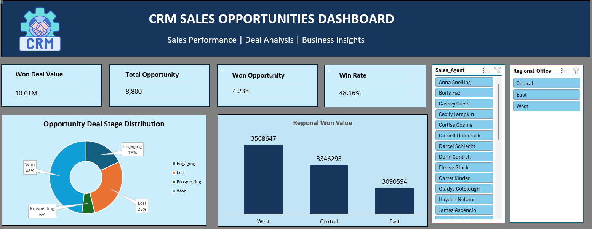
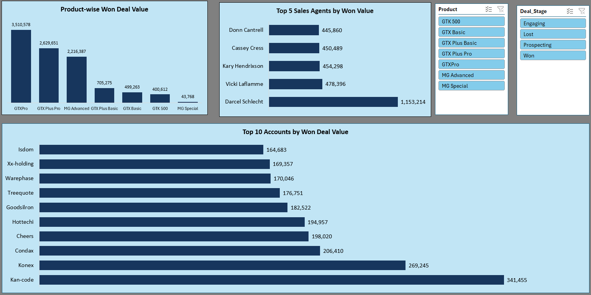
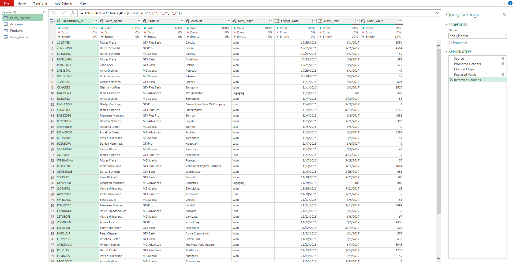
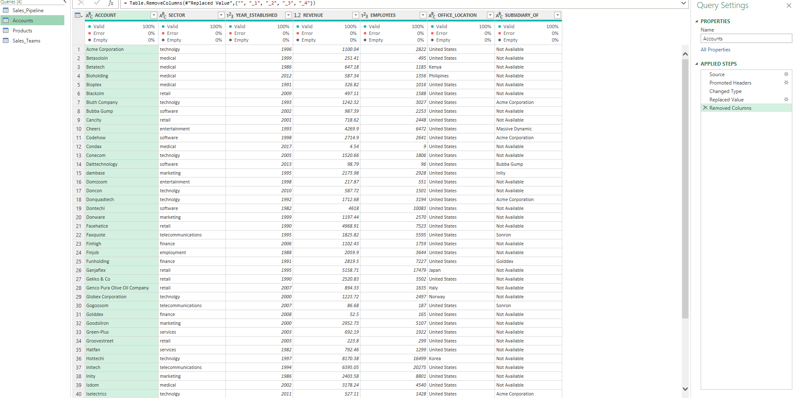
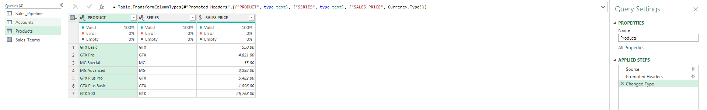
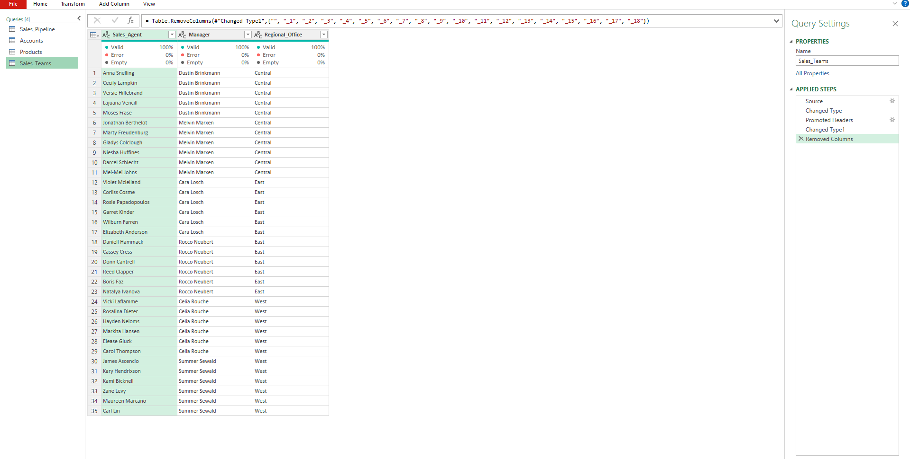
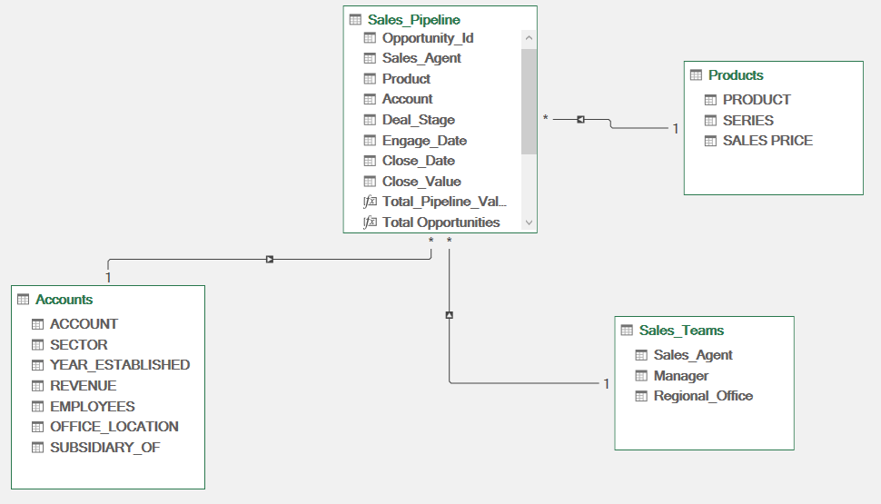
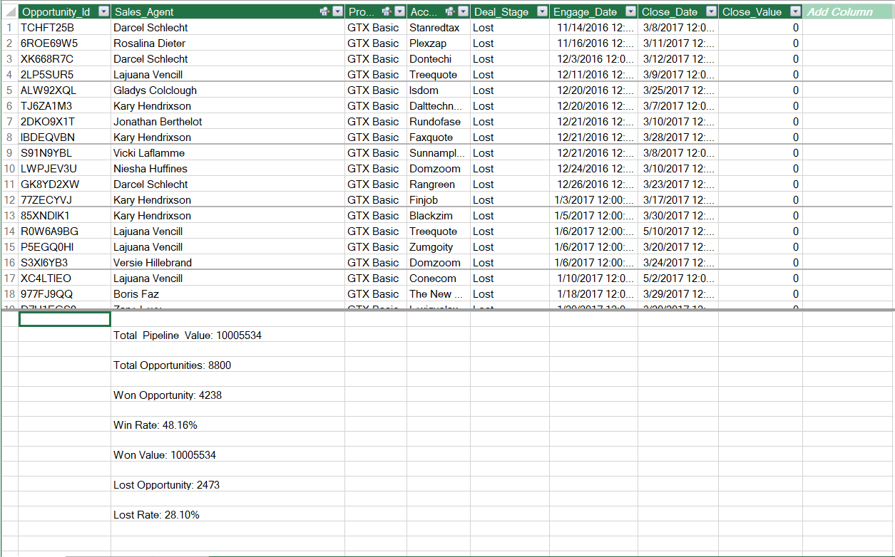
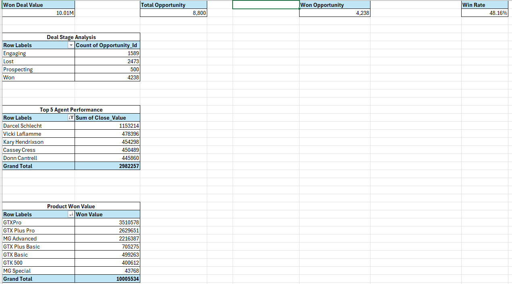
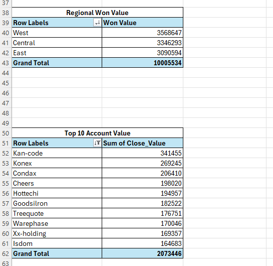

# CRM Sales Opportunities Dashboard (Excel: Power Query + Power Pivot)

Excel dashboard on a CRM sales pipeline dataset (8,800 opportunities), built with Power Query for cleaning, a Power Pivot data model with DAX measures, pivot tables, charts, and slicers.

## Dashboard

## What I did
- Power Query: loaded 4 CSV files (Sales_Pipeline, Accounts, Products, Sales_Teams), promoted headers, set data types, replaced blank accounts with "Not Available", and removed empty columns
- Power Pivot: built a 4-table data model with one-to-many relationships (Sales_Pipeline to Accounts, Products, and Sales_Teams)
- DAX measures: Total Opportunities, Won Opportunity, Lost Opportunity, Win Rate, Lost Rate, Won Value, and Total Pipeline Value
- Dashboard: pivot tables, 5 charts, and 4 slicers (Sales Agent, Regional Office, Product, Deal Stage)

## Automation
Data refresh is automated with Power Query and the data model. When the source data changes, a single Refresh All updates the cleaned tables, measures, pivot tables, charts, and KPI cards (tested by adding a new record).

## Key findings
- 8,800 opportunities: 4,238 Won (48.16% of all opportunities), 2,473 Lost, 1,589 Engaging, and 500 Prospecting
- Won deal value is about 10.01M. GTXPro is the top product (3.51M) and West is the top region (3.57M)
- Top sales agent is Darcel Schlecht with about 1.15M in won value
- About 1,425 opportunities have no account recorded and are labelled "Not Available"

## Power Query steps

## Data model and measures

## MIS analysis (pivot tables)

## Notes
- Win Rate is Won opportunities divided by all opportunities (including open Engaging and Prospecting deals)
- Total Pipeline Value and Won Value are the same here, because only Won deals have a close value

## Files
- `CRM_Sales_Opportunities_Dashboard.xlsx`: Excel file with the dashboard, pivots, and data model
- `Sales_Pipeline.csv`, `Accounts.csv`, `Products.csv`, `Sales_Teams.csv`: source data

## How to refresh
The file opens with the data already loaded. To refresh it on another computer, download the CSV files, then update the file paths in Power Query (Data > Queries & Connections > right-click a query > Edit > Source) and click Refresh All.

## Tools
Excel, Power Query, Power Pivot, DAX, Pivot Tables, Slicers
